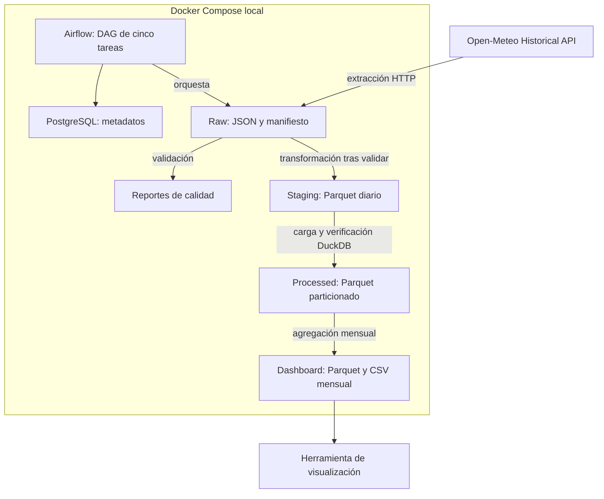

# Arquitectura y decisiones técnicas

## Componentes y flujo

PostgreSQL almacena metadatos de Airflow, no los datos meteorológicos.
Airflow orquesta todas las etapas. La herramienta de visualización es
un consumidor propuesto, no un servicio incluido en Docker Compose.

## Responsabilidades

| Módulo | Responsabilidad | Salida |
|---|---|---|
| extract.py | Consultar API y conservar evidencia | Ruta del manifiesto |
| validate.py | Validar estructura, fechas, unidades e integridad | Ruta del manifiesto validado |
| transform.py | Normalizar y calcular indicadores | Ruta del Parquet intermedio |
| load.py | Publicar particiones y verificar lectura | Directorio del dataset diario |
| dashboard.py | Agregar métricas mensuales | Ruta del Parquet mensual |
| weather_pipeline_dag.py | Definir dependencias y reintentos | Ejecución orquestada |

## Decisiones

### pandas y DuckDB

El volumen esperado es de 1.290 filas diarias. pandas permite expresar
las transformaciones con claridad y DuckDB verifica la lectura del
dataset particionado mediante SQL. Spark no aporta una ventaja necesaria
para este volumen.

### Parquet y particiones Hive

Parquet conserva tipos y utiliza almacenamiento columnar con compresión
Snappy. Las particiones city/year/month cumplen el requisito y permiten
seleccionar subconjuntos.

El ejercicio produce archivos pequeños. En producción se revisaría la
granularidad de partición y se aplicaría compactación según el volumen.

### Copias independientes por extracción

Cada extracción recibe un identificador único y conserva la respuesta
original y la configuración utilizada. Esto permite rastrear resultados
aunque la API revise datos históricos.

El consumidor debe seleccionar una extracción. No existe una vista
automática de "última publicación" ni deduplicación entre extracciones.

### Idempotencia de carga

Dentro de una extracción, la huella del archivo intermedio identifica
la entrada. Repetir la carga de la misma entrada reutiliza la publicación
tras verificar sus conteos, claves y fechas. Una entrada modificada
para el mismo identificador se rechaza.

La publicación inicial utiliza una carpeta temporal y renombrado en el
mismo sistema de archivos. Esta garantía no se traslada automáticamente
a almacenamiento de objetos.

### Calidad antes de publicación

Las anomalías estructurales, fechas incorrectas, unidades inesperadas
y datos incoherentes bloquean el proceso. Los valores faltantes generan
advertencias y permanecen como desconocidos.

La huella raw se verifica durante la validación. Se presupone que los
archivos no se modifican entre esa etapa y la transformación; una mejora
es volver a verificar la integridad al transformar o usar almacenamiento
inmutable.

### Meses incompletos

El periodo termina el 15 de septiembre. El resumen informa cobertura
calendario, fechas presentes y días válidos. No extrapola acumulados.
Las tasas se calculan sobre indicadores conocidos.

### Airflow local

Se utiliza standalone con LocalExecutor y PostgreSQL para simplificar
el arranque. Las tareas intercambian rutas mediante XCom y comparten
el mismo directorio de datos.

El DAG no tiene programación automática, no hace catchup y limita a uno
el número de runs activos. Las excepciones se propagan para permitir
que Airflow registre fallos y aplique reintentos.

### Seguridad y operación

La interfaz se publica en localhost. Las credenciales de PostgreSQL
son de demostración local; no son apropiadas para producción.
El directorio runtime y el archivo .env están excluidos de Git.

Para producción: separar servicios, usar gestión de secretos,
almacenamiento compartido durable, monitorización, alertas y CI.

## Alcance de las verificaciones realizadas

- Ejecución real de las cinco tareas en Airflow.
- Lectura real del Parquet particionado con DuckDB.
- Validación de 1.290 filas y 45 particiones.
- Generación de 45 registros mensuales.
- Doce casos automatizados aprobados.

Estas verificaciones no equivalen a pruebas de carga, disponibilidad,
recuperación ante desastres ni cobertura completa de fallos de red.
